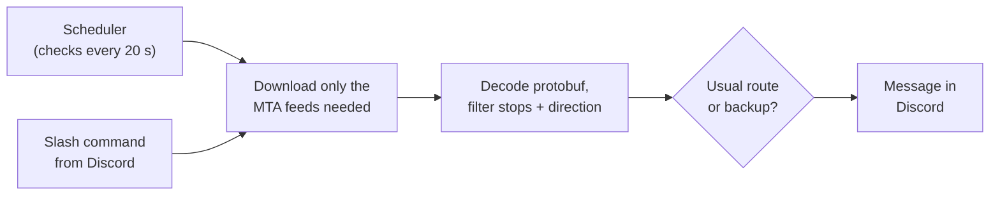

# Commute Alerts

**A Discord bot that tells me which subway train to take, using live MTA data.**

My commute home has a transfer where I choose between two routes. Pick wrong and I'm stuck waiting for a delayed train, underground with spotty signal. This bot reads the MTA's live train feeds, checks the waits, and tells me which way to go. It also sends a briefing before I leave, on the days I choose.

It works for any NYC subway commute: your stops live in a private config file, never in the code.

## Features

| Command | What it does |
|---|---|
| `/briefing` | Service alerts for your lines, plus the next trains at every stop on your trip |
| `/choose` | At your transfer: take the usual route or the backup? |
| `/week` | Pick which days you want automatic briefings |
| `/status` | Is the bot running? What did it last send? |
| `/help` | List the commands and the schedule |

- **Scheduled briefings.** Every Sunday night the bot asks which days you want alerts, then sends a briefing before each trip on those days.
- **Only the alerts that matter.** Alerts for other lines or the other direction are dropped.

## Example

<table>
<tr><th><code>/briefing</code></th><th><code>/choose</code></th></tr>
<tr><td>

```
🚇 Trip home · 6:00 PM

⚠️ Alerts
- Downtown [A] trains are delayed

1/2/3 · 96 St
   2 in 3 min (6:03)
   1 in 5 min (6:05)
   3 in 8 min (6:08)

A · 42 St–Port Authority
   in 12 min (6:12)
   in 19 min (6:19)
```

</td><td>

```
📍 At 96 St · 6:01 PM

👉 Take the 2/3 → A
   2/3 · 96 St: 6:03
   A · 42 St–Port Authority: 6:12
     (0 min wait)
   C backup: 6:05
```

</td></tr>
</table>

## How it works



- **Live data.** The MTA publishes subway positions as [GTFS-realtime](https://gtfs.org/realtime/) protobuf feeds, split across 8 feeds by line. The bot downloads only the feeds a trip needs, in parallel. No API key required.
- **Decision rule.** If the first train is more than `maxWaitMin` away, take the backup. Otherwise add the transfer walk and check the wait for the connecting train; if that's too long, take the backup.
- **Config validation.** `trips.json` is checked with `zod` at startup, and errors point to the exact field: `trips.0.stops.1.stopId: should look like "120S"`.
- **Time zones.** Scheduling uses New York time, so it stays correct across daylight saving and on UTC servers.

<details>
<summary><b>Project structure</b></summary>

```
src/
  bot.ts            Discord bot: slash commands and the scheduler
  messages.ts       builds the briefing and /choose text
  mta.ts            which feed has which line; downloads and reads feeds
  find-arrivals.ts  next trains at a platform
  find-alerts.ts    alerts on my lines, in my direction
  decide.ts         usual route or backup?
  schedule.ts       what is due now; the days picked this week
  config.ts         loads and checks trips.json
  briefing.ts       run a briefing in the terminal
  choose.ts         run a decision in the terminal
tests/              unit tests (offline, no network)
```

</details>

## Getting started

**Requirements:** [Node.js](https://nodejs.org) 20+ and a Discord server you manage.

```bash
git clone https://github.com/IsmaelEnriquez/commute-alerts.git
cd commute-alerts
npm install
cp trips.example.json trips.json   # then fill in your stops
```

**1. Add your stops.** Each stop needs a stop code: the station ID plus `N` (uptown) or `S` (downtown), like `120S` for 96 St downtown on the 1/2/3. Station IDs are in `stops.txt` in the MTA's [static subway data](https://rrgtfsfeeds.s3.amazonaws.com/gtfs_subway.zip). Test it without Discord:

```bash
npx tsx src/briefing.ts evening
```

**2. Create a Discord bot.** In the [Developer Portal](https://discord.com/developers/applications), create an application, open **Bot**, and copy the token. Under **OAuth2 → URL Generator**, check `bot` and `applications.commands` with the **Send Messages** permission, then open the link to add it to your server. To get the channel ID, turn on Developer Mode in Discord and right-click the channel.

**3. Add your secrets** to a `.env` file:

```bash
DISCORD_BOT_TOKEN=your-token
DISCORD_CHANNEL_ID=your-channel-id
```

**4. Run it,** then type `/help` in your channel:

```bash
npm run bot
```

`trips.json` and `.env` are git-ignored, so your commute and token never leave your machine.

## Testing

```bash
npm test
```

Tests cover the decision rule, arrival and alert filtering, config validation, and the weekly schedule (including daylight saving). They use small fake feeds and run offline.

## Deployment

The bot runs 24/7 on an Oracle Cloud Ubuntu VM (Always Free tier) as a `systemd` service that restarts on crashes and reboots. It only makes outgoing connections, so the server has no open ports besides SSH.

## Roadmap

- [ ] **Multi-user:** one hosted bot anyone can add, with commutes stored in Postgres
- [ ] **Stop finder:** `npm run stops "union sq"` to look up stop codes
- [ ] **CI:** run the tests on every push with GitHub Actions

## Built with

TypeScript · Node.js · discord.js · gtfs-realtime-bindings · zod · Node test runner